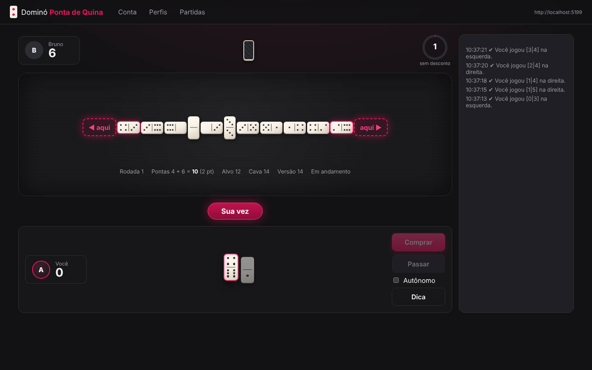
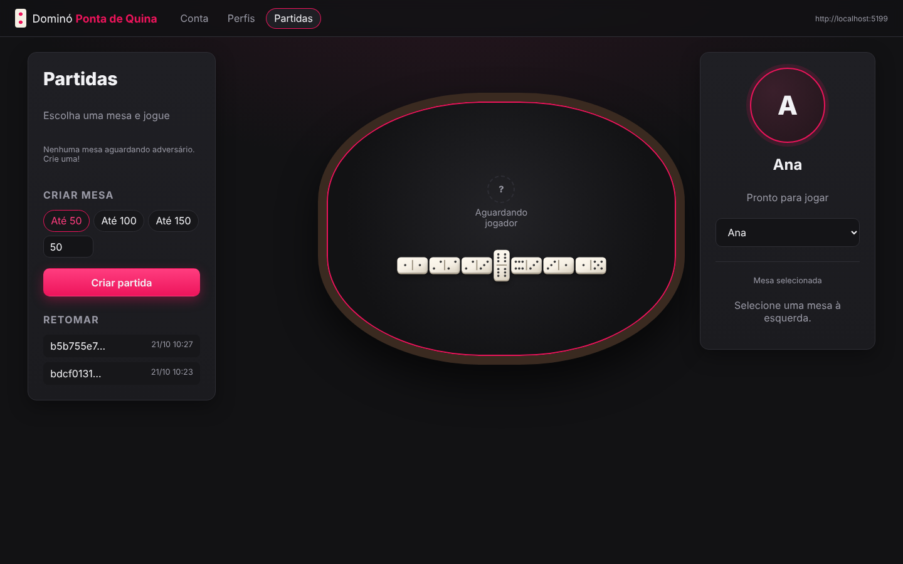
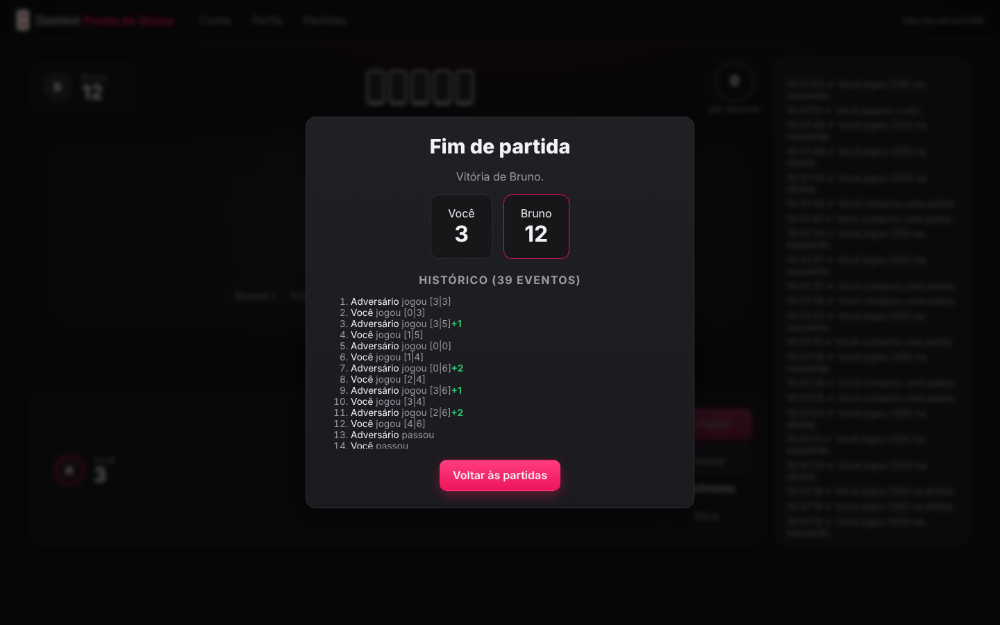

# Dominó Ponta de Quina — Cliente C#

Cliente próprio para jogar partidas completas de **Dominó Ponta de Quina** pela API do Checkpoint 6 (FIAP).
Ele solicita acesso, autentica, ativa um jogador-perfil, cria ou entra em partidas, mostra a mesa como um jogo,
envia apenas ações permitidas e acompanha o estado até o resultado — com **jogador autônomo** para enfrentar outros grupos.



> **Checkpoint 6 — entrega até 02/11/2026, 23:59.**
> 🎥 **Vídeo de apresentação:** (https://youtu.be/llHll5-5D0k)
>
> **Integrantes:** _Victoria Moura (RM555474)_

---

## Sumário

1. [O que foi entregue](#o-que-foi-entregue)
2. [Requisitos](#requisitos)
3. [Como configurar e executar](#como-configurar-e-executar)
4. [Fluxo de uso (interface web)](#fluxo-de-uso-interface-web)
5. [Linha de comando e jogador autônomo](#linha-de-comando-e-jogador-autônomo)
6. [Testes automatizados](#testes-automatizados)
7. [Simulador local da API](#simulador-local-da-api)
8. [Arquitetura](#arquitetura)
9. [Como o cliente conversa com a API](#como-o-cliente-conversa-com-a-api)
10. [Tratamento de erros](#tratamento-de-erros)
11. [Estratégia do jogador autônomo](#estratégia-do-jogador-autônomo)
12. [Convenções adotadas](#convenções-adotadas)
13. [Mapa dos critérios de avaliação](#mapa-dos-critérios-de-avaliação)

---

## O que foi entregue

| Item | Onde |
|---|---|
| Interface web com aparência de jogo (mesa, pedras, placar, turno, relógio) | `src/DominoQuina.Web` |
| Cliente de linha de comando + jogador autônomo | `src/DominoQuina.Cli` |
| Núcleo reutilizável: cliente HTTP, modelos, regras, estratégia, sessão de partida | `src/DominoQuina.Core` |
| Simulador local da API (mesmo contrato) para testes e ensaio offline | `tools/DominoQuina.Simulador` |
| Testes automatizados (xUnit): 76 casos de unidade e integração ponta a ponta | `tests/DominoQuina.Tests` |
| Diagrama de classes | [`docs/diagrama-classes.md`](docs/diagrama-classes.md) e [`.png`](docs/diagrama-classes.png) |
| Roteiro do vídeo de apresentação | [`docs/roteiro-video.md`](docs/roteiro-video.md) |

## Requisitos

- [.NET SDK 8.0](https://dotnet.microsoft.com/download/dotnet/8.0) (`dotnet --version` deve mostrar `8.x`)
- Um e-mail `@fiap.com.br` para receber o token
- Navegador moderno (Chrome, Edge ou Firefox)

## Como configurar e executar

```bash
git clone <url-do-repositorio>
cd domino-quina-cliente
dotnet restore
dotnet build
```

### Interface web (recomendada)

```bash
dotnet run --project src/DominoQuina.Web
```

Abra **http://localhost:5080**. O endereço padrão da API já vem configurado:

```
https://domino-quina-api-b1-pf2261.azurewebsites.net
```

Swagger: <https://domino-quina-api-b1-pf2261.azurewebsites.net/swagger>.
O enunciado também cita `https://domino-quina-atbkg6ckcwbpd5gz.westus3-01.azurewebsites.net`. Para trocar, use
**Conta → Configuração** (informe só o endereço base, **sem** `/swagger`) ou a linha de comando:
`dotnet run --project src/DominoQuina.Cli -- url https://outro-endereco`. Cada servidor tem contas próprias, então um token de um não vale no outro.

### Onde ficam o token e as chaves

O token e as chaves de ativação ficam em `~/.domino-quina/credenciais.json`
(no Windows, `C:\Users\<voce>\.domino-quina\credenciais.json`). Em Linux/macOS o arquivo é gravado com permissão `600`.
Para usar outra pasta — por exemplo, dois “aplicativos” diferentes na mesma máquina — defina `DOMINO_QUINA_HOME`:

```bash
# PowerShell
$env:DOMINO_QUINA_HOME = "C:\temp\cliente2"; dotnet run --project src/DominoQuina.Web --urls http://localhost:5081
# bash
DOMINO_QUINA_HOME=/tmp/cliente2 dotnet run --project src/DominoQuina.Web --urls http://localhost:5081
```

> Esse arquivo é um segredo. Ele está no `.gitignore` e nunca deve ir para o repositório.

## Fluxo de uso (interface web)

1. **Conta** — informe o e-mail FIAP e clique em *Enviar*. A API responde `202` e envia o token por e-mail.
   Cole o token e clique em *Entrar*. O cliente valida em `GET /api/identidade/sessao` e guarda o token
   (ele é reutilizável até ser revogado, então não é pedido de novo a cada abertura).
2. **Perfis** — crie um perfil ou use um existente e clique em *Ativar aqui*. O cliente gera 32 bytes aleatórios
   (64 hexadecimais), **guarda a chave antes de enviar** e chama `ativar-cliente`. *Retomar* repete a ativação com a
   mesma chave; *Liberar* chama `desativar-cliente` para usar o perfil em outro cliente.
3. **Partidas** — escolha a pontuação alvo e crie a mesa, ou selecione uma mesa com vaga e clique em *Entrar na partida*.
   A lista se atualiza a cada 3 s e a vaga é revalidada pela API no ingresso.
   Mesas em que o perfil atual já participa aparecem com o selo **Sua mesa**: clicar nelas reabre a partida.
   A API não deixa o mesmo perfil abrir uma segunda mesa enquanto já espera em outra, por isso
   *Criar partida* retoma a mesa existente nesse caso.
4. **Mesa** — quando houver dois jogadores, clique em *Iniciar*. Na sua vez:
   - pedras que encaixam ficam destacadas; as outras ficam apagadas;
   - clique na pedra para jogar; se ela couber nas duas pontas, aparecem os botões **◀ aqui** e **aqui ▶**;
   - *Comprar* e *Passar* só ficam habilitados quando o estado indica essa ação;
   - *Dica* sugere a melhor jogada; o interruptor **Autônomo** faz o cliente jogar sozinho;
   - o relógio mostra o tempo do turno e o desconto previsto pela regra futura (0/1/2/3 pontos).
5. **Resultado** — ao fim, aparece o placar final, o vencedor e o histórico de eventos (`/resultado`).

| Sala de partidas | Resultado |
|---|---|
|  |  |

A mão do adversário **nunca** é exibida: só aparece a quantidade de pedras, com o verso para cima.

## Linha de comando e jogador autônomo

```bash
cd src/DominoQuina.Cli
dotnet run -- token aluno@fiap.com.br          # pede o token por e-mail
dotnet run -- login <TOKEN>                    # guarda e valida
dotnet run -- criar-perfil "Robô do Grupo"     # cria um perfil
dotnet run -- perfis                           # lista e mostra quais estão ativos aqui
dotnet run -- ativar <jogadorId>               # ativa neste cliente
dotnet run -- partidas                         # mesas com vaga
```

Jogador autônomo (joga a partida inteira sozinho, mostrando a mesa no terminal):

```bash
dotnet run -- autonomo --jogador <jogadorId> --criar 50            # cria a mesa e espera o adversário
dotnet run -- autonomo --jogador <jogadorId> --entrar              # entra na primeira mesa com vaga
dotnet run -- autonomo --jogador <jogadorId> --entrar <partidaId>  # entra numa mesa específica
dotnet run -- autonomo --jogador <jogadorId> --partida <partidaId> # retoma após fechar o programa
```

Também é possível jogar manualmente no terminal: `dotnet run -- jogar --jogador <id> --entrar`.
Outros comandos: `sessao`, `sair [--revogar]`, `desativar <jogadorId>`, `resultado --jogador <id> --partida <id>`, `url <endereço>`.

## Testes automatizados

```bash
dotnet test
```

Os testes ficam em `tests/DominoQuina.Tests` (xUnit) e não dependem da API oficial nem de internet:

| Grupo | O que verifica |
|---|---|
| `MotorRegrasTests` | Pontas da mesa, orientação das pedras, jogadas válidas, abertura obrigatória, tabela de pontos (5→1, 10→2, 15→3). |
| `EstrategiaEDecisorTests` | Estratégia sempre escolhe jogada válida (200 mãos aleatórias), prioriza pontuar; decisão por `proximaAcao`. |
| `SerializacaoTests` | Enums numéricos ou em texto, camelCase, `estadoAutoritativo`, chave de ativação de 64 hex. |
| `DominoApiClientTests` | Cabeçalhos `Authorization` e `X-Jogador-Ativacao`, 204, 400, 422, 429 (`Retry-After`), repetição só em ações idempotentes com a **mesma** chave. |
| `SessaoEPerfisTests` | Só aplica versões novas; 409 adota o estado oficial; 422 não avança; nova chave de idempotência por intenção; ciclo de ativação/liberação. |
| `CronometroECredenciaisTests` | Tabela de desconto por demora; persistência e permissão do arquivo de credenciais. |
| `SimuladorIntegracaoTests` | **Ponta a ponta**: dois jogadores autônomos jogam uma partida inteira até o vencedor; distribuição de 7 pedras; rejeições sem avanço; 409 por versão; `JOGADOR_JA_ATIVO`; 204; token revogado → 401. |

Cobertura de código (opcional): `dotnet test --collect:"XPlat Code Coverage"`.

## Simulador local da API

Para ensaiar sem depender da API oficial (ou testar dois jogadores ao mesmo tempo):

```bash
dotnet run --project tools/DominoQuina.Simulador            # sobe em http://localhost:5199
dotnet run --project src/DominoQuina.Cli -- url http://localhost:5199
```

O simulador implementa as mesmas rotas, os mesmos códigos de erro e as regras do enunciado. Como não envia e-mail,
o token pode ser obtido em `GET http://localhost:5199/simulador/token?email=voce@fiap.com.br` (rota exclusiva do simulador).
Ele é uma ferramenta de desenvolvimento: **a API oficial é sempre a autoridade**.

## Arquitetura

```
domino-quina-cliente/
├── src/
│   ├── DominoQuina.Core/          # sem dependência de interface
│   │   ├── Api/                   # IDominoApi, DominoApiClient, ApiException, OpcoesJson
│   │   ├── Armazenamento/         # ICredenciaisCliente (token, chaves, partidas recentes)
│   │   ├── Modelos/               # contrato: Peca, EstadoPartidaParticipante, requisições...
│   │   ├── Regras/                # MotorRegras (pontas, encaixe, pontos), CronometroTurno
│   │   ├── Estrategia/            # IEstrategiaJogada, EstrategiaPontuadora
│   │   └── Servicos/              # GerenciadorPerfis, SessaoPartida, DecisorAcao, JogadorAutonomo
│   ├── DominoQuina.Web/           # Blazor Server: Conta, Perfis, Sala, Mesa
│   └── DominoQuina.Cli/           # comandos de terminal e modo autônomo
├── tools/DominoQuina.Simulador/   # simulador da API
├── tests/DominoQuina.Tests/       # xUnit
└── docs/                          # diagrama de classes, telas, roteiro do vídeo
```

Veja o [diagrama de classes](docs/diagrama-classes.md) completo.

## Como o cliente conversa com a API

| Etapa | Rota | Detalhe do cliente |
|---|---|---|
| Token | `POST /api/identidade/token` | 202 sem corpo; 400 = e-mail fora de `@fiap.com.br`; 429 respeita `Retry-After`. |
| Sessão | `GET /api/identidade/sessao` | Valida o token antes de guardá-lo. |
| Perfis | `GET/POST /api/jogadores` | Nome de 1 a 150 caracteres. |
| Ativar | `POST /api/jogadores/{id}/ativar-cliente` | Chave gerada com `RandomNumberGenerator`, salva antes do envio, reaproveitada para retomar. |
| Liberar | `DELETE /api/jogadores/{id}/desativar-cliente` | Envia a chave atual e a apaga localmente. |
| Partidas | `GET/POST /api/partidas`, `POST .../entrar`, `POST .../iniciar` | Entrar usa a `versaoEstado` da listagem. |
| Estado | `GET /api/partidas/{id}?jogadorId=` | Ao abrir ou reconectar. |
| Atualizações | `GET .../atualizacoes?jogadorId=&versaoConhecida=` | A cada 1 s; 204 = nada mudou; só aplica versões **mais novas**. |
| Ações | `POST .../jogar`, `.../comprar`, `.../passar` | `versaoEsperada` do último estado + **UUID novo por intenção**; a resposta já traz o estado confirmado e é aplicada na hora. |
| Resultado | `GET .../resultado?jogadorId=` | Placar, vencedor e histórico. |

Todas as rotas privadas do jogador enviam `Authorization: Bearer <token>` **e** `X-Jogador-Ativacao: <chave>`.
O JSON usa camelCase e enums numéricos; o cliente também aceita enums em texto, por segurança.

## Tratamento de erros

| HTTP | O que o cliente faz |
|---|---|
| 401 | Mostra “Token ausente, inválido ou revogado” com link para autenticar novamente. |
| 403 | Explica que o usuário ou perfil não tem permissão. |
| 409 `CONFLITO_DE_ESTADO` | Aplica o `estadoAutoritativo` (ou recarrega) e avisa que outra ação chegou antes. |
| 409 `JOGADOR_JA_ATIVO` | Explica que o perfil está em outro cliente e como liberá-lo; descarta a chave recém-gerada. |
| 422 | Mostra o motivo (`FORA_DO_TURNO`, `ENCAIXE_INVALIDO`, `PECA_AUSENTE`, `PASSAGEM_NAO_PERMITIDA`, `ESTADO_INVALIDO`). **A partida não avança** na tela. |
| 429 | Informa o tempo de espera. |
| Falha de rede | Ações idempotentes são repetidas com o mesmo corpo (mesma chave); depois o estado é recarregado. Criar partida não é repetido automaticamente para não abrir duas mesas. |

Nenhuma ação rejeitada é exibida como se tivesse dado certo.

## Estratégia do jogador autônomo

`EstrategiaPontuadora` avalia cada jogada possível:

1. **Pontos imediatos** (soma das pontas múltipla de 5) — peso maior;
2. **Risco**: maior pontuação que o adversário poderia fazer em seguida, considerando só pedras que não estão na nossa mão nem na mesa;
3. **Descarte de peso**: prefere livrar-se de pedras altas e duplas (contam contra no travamento);
4. **Flexibilidade**: prefere manter pedras que continuem encaixando nas novas pontas.

`DecisorAcao` segue sempre a `proximaAcao` informada pela API (abertura obrigatória, jogar, comprar, passar).
Se a API rejeitar uma jogada (422), o autônomo recarrega o estado e tenta comprar; se a compra for rejeitada, tenta passar.
Ele responde em menos de 1 segundo — bem abaixo dos 10 segundos da regra futura de desconto por demora.

## Convenções adotadas

- C# 12 / .NET 8, `Nullable` habilitado, analisadores (`AnalysisLevel latest-recommended`) e `.editorconfig` na raiz.
- Nomes em PascalCase, campos privados `_camelCase`, interfaces com `I`, métodos assíncronos com sufixo `Async`, namespaces por arquivo.
- Domínio em português, alinhado ao contrato da API (`Partida`, `Jogada`, `Pedra`).
- Documentação XML (`///`) em todos os tipos públicos do núcleo; `GenerateDocumentationFile` ligado.
- Segredos fora do repositório (`.gitignore`).

## Mapa dos critérios de avaliação

| Critério | Peso | Evidência |
|---|---|---|
| Documentação do código e README | 5% | Este README + XML docs em `DominoQuina.Core`. |
| Respeito às convenções | 5% | `.editorconfig`, analisadores, padrões .NET. |
| Vídeo de apresentação | 10% | Link no topo deste README; roteiro em [`docs/roteiro-video.md`](docs/roteiro-video.md). |
| Diagrama de classes | 10% | [`docs/diagrama-classes.md`](docs/diagrama-classes.md). |
| Conexão funcional com a API e registro de usuário e jogador | 15% | Telas Conta e Perfis; `GerenciadorPerfis`; `DominoApiClient`. |
| Partidas executadas com o estado correto na tela | 20% | Tela Mesa; `SessaoPartida` (versões, 409, 422, 204). |
| Testes automatizados | 15% | `tests/DominoQuina.Tests` — 76 casos, incluindo partida completa ponta a ponta. |
| Partidas executadas com jogador autônomo | 20% | `JogadorAutonomo` (web: interruptor *Autônomo*; CLI: `autonomo`). |
