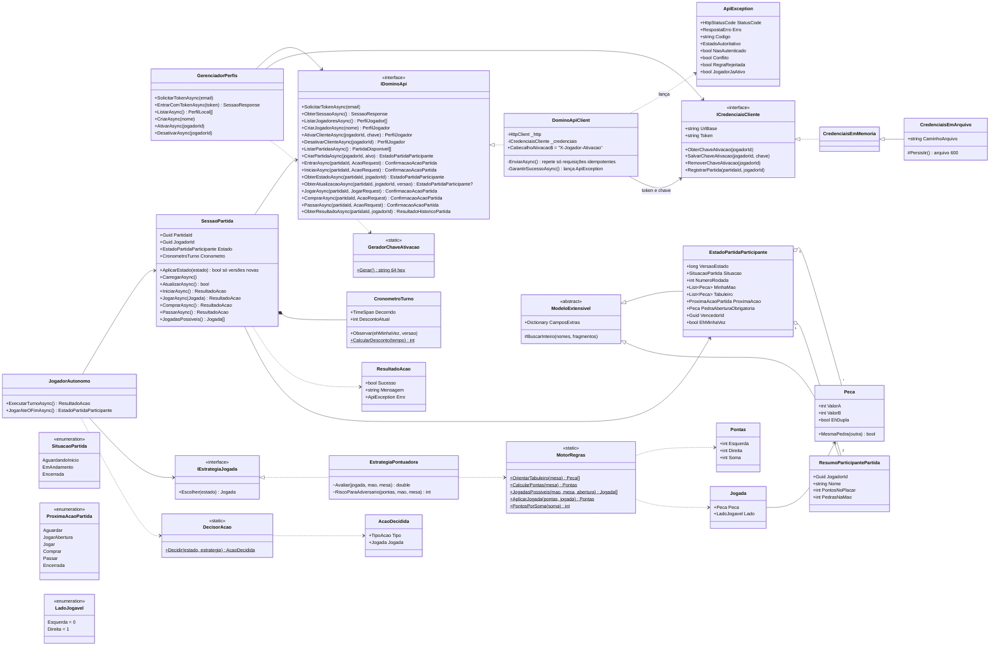

# Diagrama de classes

Visão das classes principais do núcleo (`DominoQuina.Core`) e de quem as usa (console, web e testes).
O GitHub desenha o diagrama abaixo automaticamente. A mesma figura está em [`diagrama-classes.png`](diagrama-classes.png).

## Camadas

| Projeto | Papel |
|---|---|
| `DominoQuina.Core` | Modelos do contrato, cliente HTTP, regras locais (exibição e dicas), estratégia, sessão de partida e jogador autônomo. Não depende de interface. |
| `DominoQuina.Web` | Interface Blazor Server com aparência de jogo: conta, perfis, sala de partidas e mesa. Usa `SessaoPartida` e `JogadorAutonomo`. |
| `DominoQuina.Cli` | Linha de comando: autenticação, perfis, jogador autônomo e partida no terminal (útil para jogar contra outros grupos). |
| `DominoQuina.Simulador` | Simulador local da API (mesmas rotas e regras) usado pelos testes de integração e para ensaiar sem internet. |
| `DominoQuina.Tests` | Testes xUnit de unidade e de integração ponta a ponta. |

## Princípios do desenho

- **A API é a autoridade.** `MotorRegras` só serve para desenhar a mesa, destacar pedras jogáveis e sugerir jogadas; quem valida e pontua é o servidor.
- **Estado só avança.** `SessaoPartida.AplicarEstado` ignora versões mais antigas, então respostas atrasadas ou consultas paralelas não “voltam no tempo”.
- **Uma intenção, uma chave.** Cada ação gera um UUID novo; repetições por falha de rede reaproveitam o mesmo corpo (mesma chave), sem duplicar jogadas.
- **Rejeição não é sucesso.** 409 aplica o `estadoAutoritativo`; 422 mostra o motivo e mantém o estado; 401 pede nova autenticação.
- **Inversão de dependência.** Serviços dependem de `IDominoApi`, `ICredenciaisCliente` e `IEstrategiaJogada`, o que permite testes com dublês e a troca de estratégia.
